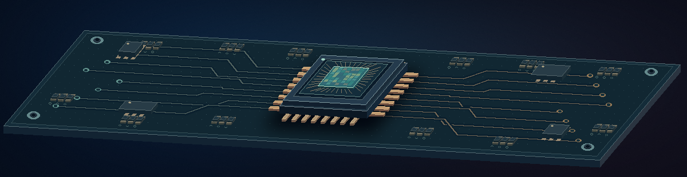
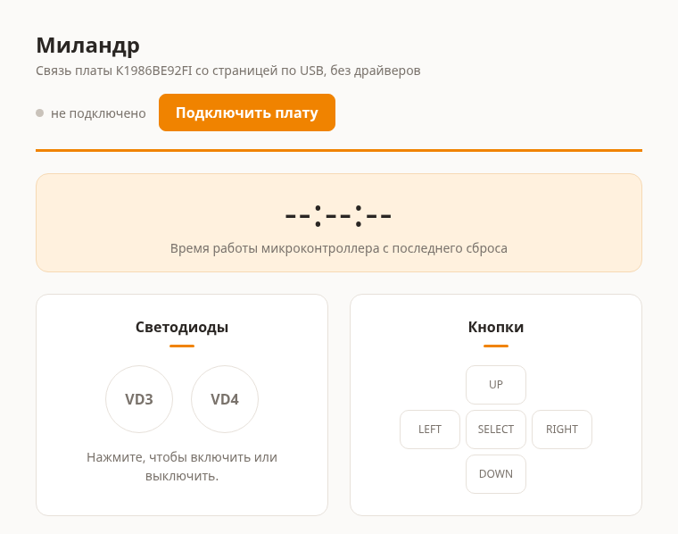

  
  <h1>Ilya Lampadov</h1>
  
<strong>Инженер встраиваемой техники · Embedded Systems Engineer</strong>

  
Аппаратная часть · Встраиваемое ПО · Законченные изделия

---

## Обо мне

Довожу электронные изделия от выбора элементной базы и запуска прототипа до отладки и испытаний готового устройства. Работаю с микросхемами разной сложности, разрабатываю драйверы и встраиваемое ПО, интегрирую прошивку с аппаратной частью.

## Избранные проекты

### TinyUSB для микроконтроллеров Миландр

`C` · `ARM Cortex‑M3` · `TinyUSB 0.21.0` · `Keil µVision`

Порт USB Device и семь примеров для **К1986ВЕ92FI**. Один драйвер контроллера используется в прошивках с виртуальным COM-портом, мышью, клавиатурой, накопителем и WebUSB.

  
   
  Веб-интерфейс управления платой до подключения.

В примере **MSC + WebUSB** плата определяется как USB-диск. На нём лежит страница, с которой можно управлять светодиодами, видеть нажатия кнопок и считывать показания АЦП. Файлы страницы хранятся во Flash, поэтому демо можно открыть без подключения к интернету.

- **Драйвер USB.** Обработка прерываний, управление конечными точками и обмен через FIFO.
- **Проверка на хосте.** Скрипты для циклов энумерации, нагрузочных тестов CDC и проверки накопителя.

[Репозиторий](https://github.com/Lampadov/tinyusb-milandr-examples) · [Код драйвера](https://github.com/Lampadov/tinyusb-milandr-examples/blob/main/src/tusb_MDR32Fx.c) · [Запуск демо](https://github.com/Lampadov/tinyusb-milandr-examples/tree/main/examples/msc-webusb)

## Технологии

| Область | С чем работаю |
| --- | --- |
| Аппаратная часть | Элементная база, запуск плат и проверка работы устройства |
| Прошивка | C, драйверы и прикладная логика микроконтроллеров |
| Периферия | GPIO, таймеры, АЦП |
| Интерфейсы | UART, SPI, I²C, USB |
| Отладка и проверка | Keil µVision, отладка на плате, скрипты на Python |
