  
  <h1>Ilya Lampadov</h1>
  
<strong>Инженер встраиваемой техники · Embedded Systems Engineer</strong>

## Обо мне

Разрабатываю электронные изделия и довожу их до рабочего устройства. Работаю с микросхемами разной сложности, запускаю платы, пишу драйверы и прошивки. Проверяю на стенде, как всё это работает вместе.

В своих статьях для портала Миландр (Milandr) разбираю такие задачи на конкретных платах. В проектах ниже можно открыть исходники и повторить описанные опыты.

## Избранные проекты

### TinyUSB для микроконтроллеров Миландр

Подключаем К1986ВЕ92FI к ПК и видим USB-диск. Открываем с него страницу и управляем светодиодами прямо из браузера. На том же порте TinyUSB работают ещё шесть примеров, среди них виртуальный COM-порт, мышь и клавиатура. [Проект](https://github.com/Lampadov/tinyusb-milandr-examples) · [Драйвер USB](https://github.com/Lampadov/tinyusb-milandr-examples/blob/main/src/tusb_MDR32Fx.c) · [Демо MSC + WebUSB](https://github.com/Lampadov/tinyusb-milandr-examples/tree/main/examples/msc-webusb).

  

### Другие примеры

| Задача | Что посмотреть |
| --- | --- |
| Измерительный тракт | Как поток от изолированного модулятора превращается в 24-разрядные отсчёты в ADCUI. [MDR1206FI + MDR5103FI](https://github.com/Lampadov/mdr1206fi-adcui-demo) |
| Внешняя память | Чтение, запись и проверка памяти К1636РР4У через SSP на двух платформах. [Драйвер Flash](https://github.com/Lampadov/k1636rr4u-flash-driver) |
| Обработка сигналов | Пик 333 Гц в FFT и сравнение аппаратного CORDIC с `math.h`. [CMSIS-DSP и CORDIC](https://github.com/Lampadov/milandr-embedded-dsp) |
| Запуск и отладка | Сборка через GNU Make и запуск из ОЗУ через J-Link или CMSIS-DAP. [К1986ВЕ8Т в VS Code](https://github.com/Lampadov/k1986ve8t-vscode-template) |
| ОСРВ | Задачи FreeRTOS на двух МК и системный тик RTX5 от TIMER1. [FreeRTOS и RTX5](https://github.com/Lampadov/milandr-rtos-examples) |
| Аудио | Воспроизведение отсчётов WAV через два ЦАП и усилитель TPA6130A2. [WAV на К1986ВК01GI](https://github.com/Lampadov/k1986vk01gi-wav-dac) |
| Захват и ШИМ | Захват фронтов на CAP0 и отдельный выход ШИМ с CAP3. [Захват и ШИМ на К1986ВК01GI](https://github.com/Lampadov/k1986vk01gi-capture-pwm) |
| SPI и IrDA | Эхо по SPI и управление светодиодами двух плат через ИК-порт. [Примеры SPI и IrDA](https://github.com/Lampadov/milandr-peripheral-lab) |
| Детектор питания | Проверка порогов PVD и обработка прерывания на К1986ВЕ8Т. [Пример PVD](https://github.com/Lampadov/k1986ve8t-power-pvd) |
